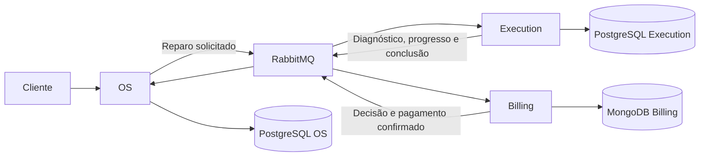

# Mecânica OS Service — Tech Challenge Fase 4

Serviço de atendimento da oficina em Java 21 e Spring Boot 4. Mantém clientes, veículos, operadores e ordens de serviço em PostgreSQL. A abertura solicita um reparo ao Execution via RabbitMQ; eventos de Execution e Billing atualizam o acompanhamento. A entrega exige reparo concluído e pagamento confirmado.

## Responsabilidades

| Serviço | Responsabilidade | Persistência |
|---|---|---|
| OS | Cadastros de atendimento, abertura, acompanhamento, histórico e entrega | PostgreSQL próprio |
| Execution | Catálogo, diagnóstico, peças, reserva e execução do reparo | PostgreSQL próprio |
| Billing | Orçamento, aprovação/recusa, cobrança e pagamento | MongoDB próprio |

Cada serviço acessa somente seu banco. A integração usa Saga por coreografia, outbox e consumidores idempotentes. Aprovar orçamento libera execução; pagamento ocorre após o reparo e antes da entrega.



## API

As rotas administrativas exigem JWT RS256. O acompanhamento é público. Na abertura, o cliente é identificado pelo UUID do `sub` do JWT; o corpo recebe `placa` e `matriculaOperador`. Itens/preços pertencem ao diagnóstico do Execution.

| Operação | Rota |
|---|---|
| Abrir atendimento | `POST /ordens-servico` |
| Listar ordens | `GET /ordens-servico` |
| Acompanhar | `GET /ordens-servico/acompanhamento/{id}` |
| Consultar solicitação de reparo | `GET /ordens-servico/{id}/reparo` |
| Consultar histórico | `GET /ordens-servico/{id}/historico?apos=0` |
| Entregar após pagamento | `POST /ordens-servico/{id}/entregar` |

Swagger e OpenAPI gerados pela aplicação: `/swagger-ui/index.html` e `/v3/api-docs`. A coleção `docs/postman/mecanica-fase3.postman_collection.json` é um artefato histórico da Fase 3 e não representa o contrato atual de catálogo, orçamento e execução.

## Execução integrada local

Mantenha `mecanica-os-service`, `mecanica-execution-service` e `mecanica-billing-service` em diretórios irmãos. No Execution, execute:

```powershell
./scripts/iniciar-integracao-os.ps1
```

O roteiro configura a chave pública local e sobe o Compose integrado. OS fica em `http://localhost:18081`, Billing em `http://localhost:18082` e Execution em `http://localhost:18083`. Consulte [inicialização e autenticação](docs/integracao-os-conclusao.md).

## Configuração

| Variável | Uso |
|---|---|
| `SPRING_DATASOURCE_URL` | JDBC do PostgreSQL da OS |
| `SPRING_DATASOURCE_USERNAME`, `SPRING_DATASOURCE_PASSWORD` | Credenciais do banco |
| `JWT_PUBLIC_KEY` | Chave pública RSA em PEM X.509 |
| `JWT_ISSUER` | Emissor esperado, padrão `mecanica-auth` |
| `MESSAGING_ENABLED` | Habilitar integração RabbitMQ |
| `RABBITMQ_HOST`, `RABBITMQ_PORT` | Endereço do broker |
| `RABBITMQ_USERNAME`, `RABBITMQ_PASSWORD` | Credenciais do broker |

Migrations Flyway antigas são preservadas. Tabelas legadas não utilizadas não são apagadas automaticamente. V7/V8 acrescentam histórico e marco das ordens preexistentes: [contrato e limites da migração](docs/historico-e-responsabilidades.md).

## Testes e qualidade

```powershell
./mvnw.cmd clean verify
```

Os testes padrão usam H2. `verify` exige cobertura JaCoCo mínima de 80% e executa PMD. Relatórios em `target/site/jacoco`, `target/pmd.xml` e `target/reports/pmd.html`. Configuração e verificação PostgreSQL: [qualidade estática](docs/qualidade-estatica.md).

O BDD dos três serviços está no Execution, em `tests/fluxo-distribuido`. Seu provedor de pagamento é simulado; não substitui a validação externa do Mercado Pago.

## Saga, histórico e operação

- [Abertura integrada](docs/abertura-os-execution.md).
- [Progresso e valor da OS](docs/progresso-os.md).
- [Histórico e responsabilidades](docs/historico-e-responsabilidades.md).
- [Pagamento e entrega](docs/pagamento-e-entrega.md).
- [Saga, compensações e pendências](docs/saga.md).
- [Cancelamento antes do início](docs/cancelamento-integrado.md).
- [Reprocessamento auditável de DLQ](docs/reprocessamento-dlq.md).

## Implantação e observabilidade

O repositório contém Dockerfile, manifests Kubernetes e workflows. Parte dos artefatos de infraestrutura/arquitetura foi herdada da Fase 3 e precisa ser conferida para a implantação final dos três serviços. A presença desses arquivos não comprova deploy, proteção de branches nem execução remota da CI.

A aplicação expõe Actuator, métricas Prometheus, logs JSON e `X-Correlation-ID`. AWS Academy e Datadog são o destino planejado; a evidência final de implantação e observabilidade distribuída continua necessária. Referências herdadas: [arquitetura](docs/architecture.md), [modelo relacional](docs/relational-model.md) e [checklist](docs/delivery-checklist.md).

[Validação local de 05/11/2026](docs/validacao-2026-11-05.md): OS, Billing e BDD distribuído; limites e pendências explícitos.

## Permissões de acesso

As operações administrativas exigem JWT de OPERADOR ou ADMINISTRADOR. Consulte [a matriz de permissões e configuração local](docs/seguranca-e-permissoes.md). As rotas públicas de acompanhamento, orçamento e checkout permanecem conforme o contrato documentado.


Plano atual: [checklist de fechamento da Fase 4](docs/entrega-fase-4.md).


## Preparação de implantação da Fase 4

Os [manifests Kubernetes](k8s/README.md) e o workflow CD estão preparados. A infraestrutura compartilhada e a estimativa de custos ficam em mecanica-os-service/infra/fase4/README.md. A preparação local não comprova provisionamento AWS ou execução remota do CD.
