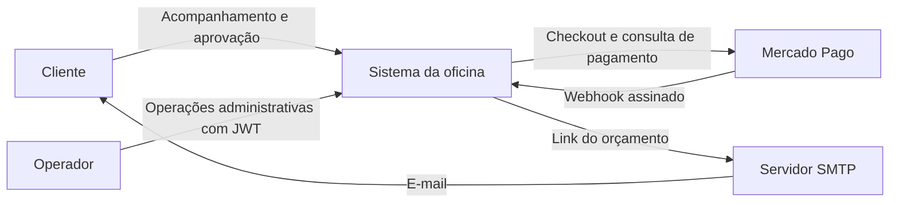
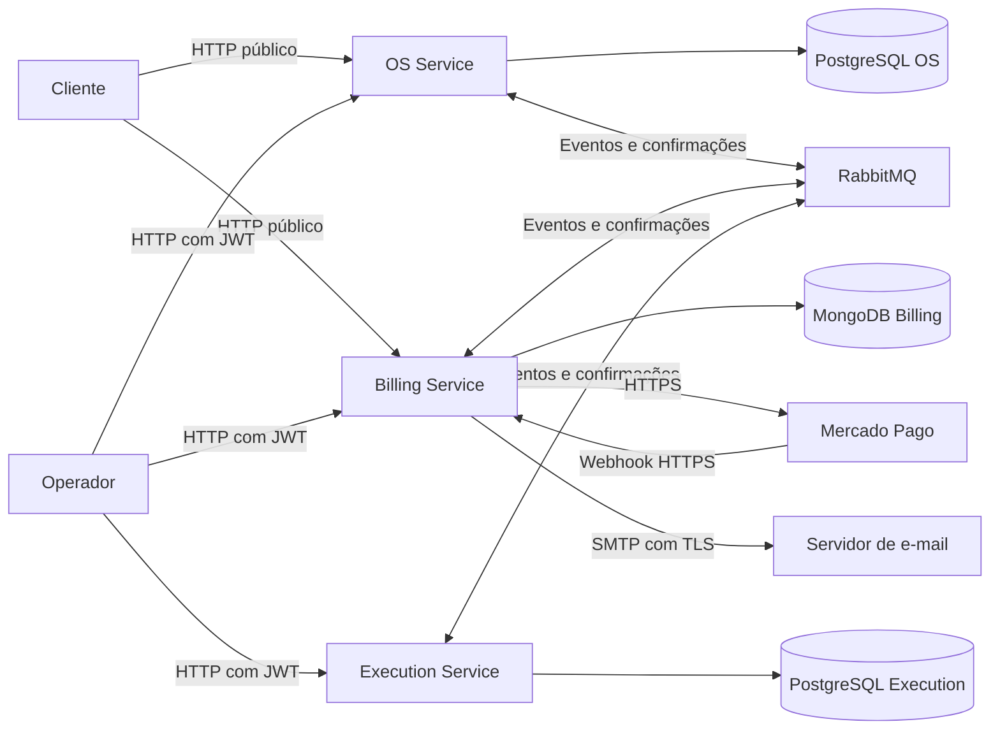
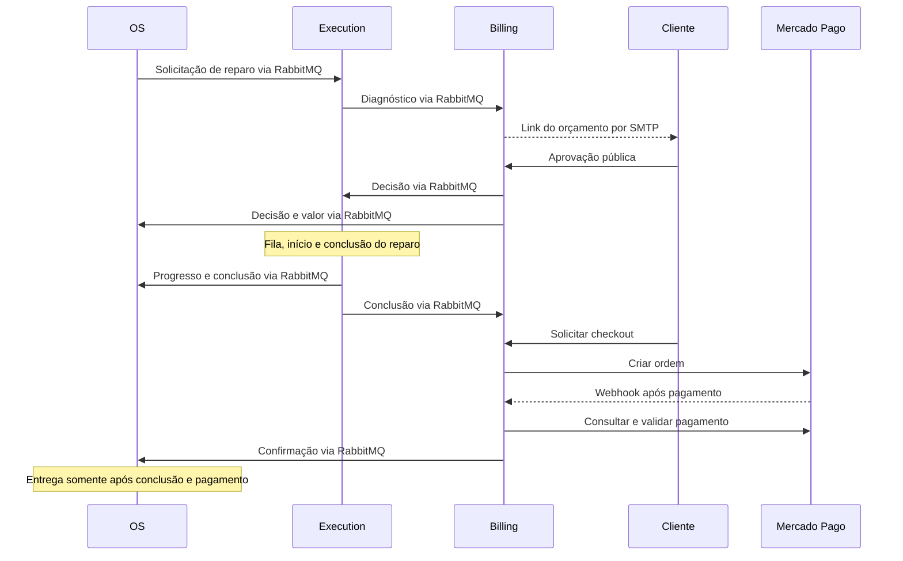
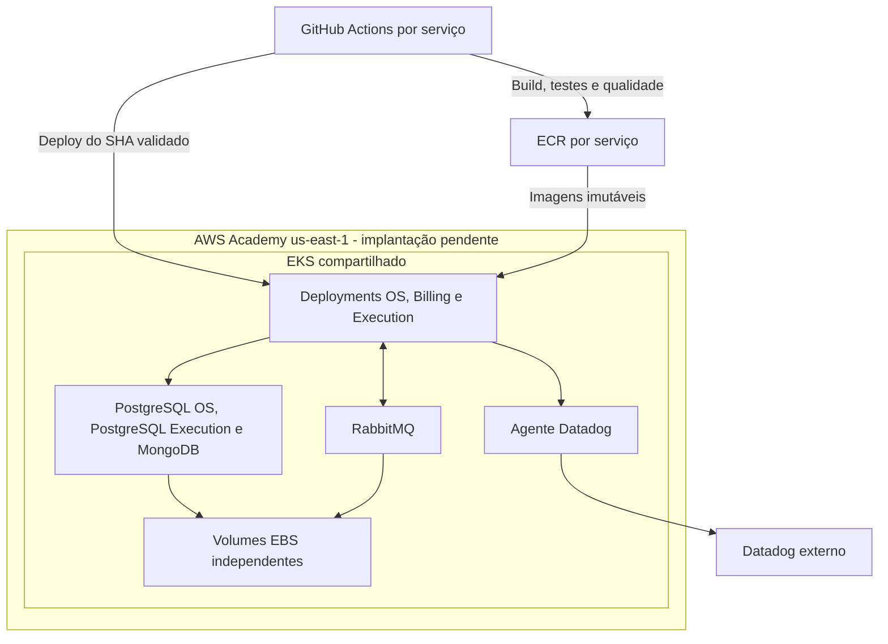

# Arquitetura da Fase 4

Revisão: 16/11/2026. O desenho lógico representa o código atual. O deploy local e dois cenários integrados na AWS foram validados; veja [evidências](validacao-integrada-aws-2026-11-16.md). CD remoto do OS validado em 17/11; SMTP local recebido em 16/11; pagamento externo pendente no WCS-59172. A [arquitetura da Fase 3](architecture.md) permanece como histórico.

## Contexto

O cliente acompanha a OS e decide o orçamento por rotas públicas. O operador usa JWT para administrar o atendimento. O Billing integra o Mercado Pago e envia o link de aprovação por SMTP. Um checkout criado não comprova pagamento.

## Serviços e bancos

| Serviço | Responsabilidade e justificativa |
|---|---|
| OS | Cadastro de clientes, veículos e operadores; abertura, acompanhamento, histórico e entrega. Mantém a visão do atendimento sem assumir execução ou cobrança. |
| Execution | Diagnóstico, serviços, peças, reservas, fila e reparo. PostgreSQL permite transações locais para estoque e compensações. |
| Billing | Orçamento, decisão, notificações, cobrança e integração financeira. MongoDB mantém os documentos e os registros de processamento; cada operação usa as garantias implementadas, sem presumir transação distribuída. |

Cada serviço tem código, Dockerfile, manifests e pipeline próprios. Nenhum lê o banco de outro. RabbitMQ e cluster são infraestrutura compartilhada; os bancos e volumes são separados. Java 21/Spring Boot uniformizam implementação e operação; RabbitMQ desacopla a evolução dos estados.

## Componentes

Controllers e consumidores traduzem entradas para casos de uso. Casos de uso aplicam regras de domínio e usam contratos de persistência, publicação e integração. Adaptadores implementam esses contratos. JWT protege operações administrativas; a configuração de segurança preserva as rotas públicas previstas no contrato.

Outbox retoma publicações; consumidores idempotentes evitam repetir efeitos. A entrega de mensagens é pelo menos uma vez. DLQ exige diagnóstico e reprocessamento auditável. O envio SMTP também pode repetir após uma falha entre a aceitação pelo servidor e a confirmação no banco.

## Saga por coreografia

A escolha evita um coordenador central e mantém cada transação no serviço responsável. Estados podem divergir temporariamente até o processamento das mensagens. Recusa/cancelamento anterior ao início libera reservas; falhas temporárias são repetidas; falhas definitivas permanecem pendentes para correção ou cancelamento explícito. Depois do reparo físico usa-se recuperação para frente. Não há estorno/chargeback automático. Consulte [Saga](saga.md) e [política de falhas](politica-falhas-saga.md).

## Implantação preparada

Topologia temporária de demonstração: um nó, Services internos, acesso por port-forward, sem alta disponibilidade. ConfigMap e Secrets fornecem configuração; valores sensíveis não ficam no repositório. Provisionamento, CD real e rastreamento Datadog ainda precisam de evidência. Detalhes e custos datados: [infraestrutura](../infra/fase4/README.md).
